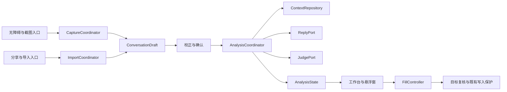
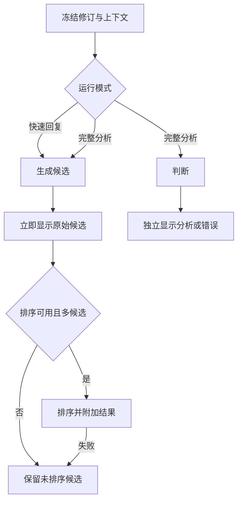

# 技术架构与数据契约

日期：2026-11-11 · 状态：设计提案。配套阅读：[产品设计](product-design.md)、[实施路线](delivery-plan.md)。

## 1. 渐进调整策略

保留现有适配器、会话令牌、回填保护、截图限频与退避。先通过包装器把旧输出转换为新模型，再逐项迁移调用方，避免同一版本同时重写采集、UI 和存储。

首阶段继续单 `app` Gradle 模块、传统 Views、JSON 存储。代码按职责分包；稳定后才按实际编译时间和依赖需求拆模块。新增依赖注入统一采用 Hilt，分阶段完成 Application、Service、Activity 和 ViewModel 接入，不同时维护多个容器。库版本在实施时核对兼容性，本设计不指定未经构建验证的版本。

UI 使用 ViewModel 暴露状态、接收用户动作；Activity 按生命周期收集。Android 官方 Views 架构建议支持这种单向数据流方式：[Recommendations for Android architecture (Views)](https://developer.android.com/topic/architecture/views/recommendations-views?hl=en)。悬浮窗由 Service 拥有明确的收集生命周期，不能假设它拥有 Activity 的生命周期。

## 2. 组件职责



| 组件 | 负责 | 不负责 |
|---|---|---|
| AccessibilityService | 系统事件、窗口节点快照、生命周期转接 | 网络重试、知识库匹配、拼接提示词 |
| CaptureCoordinator | 能力选择、节流、采集状态、旧结果丢弃 | 直接操作候选 UI |
| ImportCoordinator | URI 读取、限额、解码、OCR、临时资源回收 | 绑定真实会话或触发发送 |
| ConversationEditor | 消息校正、顺序、角色、撤销、修订号 | 修改外部聊天 |
| AnalysisCoordinator | 固定输入快照、上下文、生成／判断／排序状态 | 持有 Activity、Bitmap 或节点对象 |
| ContextRepository | 资料检索、消歧、预算和引用结果 | 私自创建联系人、替用户确认摘要 |
| FillController | 校验候选版本、目标、现有草稿、执行写入 | 猜测导入截图对应的当前会话 |
| DiagnosticsStore | 有界、脱敏的阶段元数据 | 原始聊天、截图、凭据或完整模型响应 |

领域模型保持纯 Kotlin。`Rect`、`Uri`、`AccessibilityNodeInfo`、`Context` 在 Android 边界转换，不带入长期状态。节点用完释放引用，避免将旧节点当成实时写入目标。

## 3. 统一模型

下面是契约草图，不是已编译的实现代码。字段以实现任务的兼容测试为准。

```kotlin
enum class SourceKind { ACCESSIBILITY, SCREENSHOT, IMPORT_IMAGE, PASTED_TEXT }
enum class SpeakerRole { SELF, OTHER, UNKNOWN, SYSTEM }
enum class MessageKind { TEXT, IMAGE_PLACEHOLDER, AUDIO_TRANSCRIPT, QUOTE, SYSTEM }
enum class IdentityStatus { CONFIRMED, INFERRED, AMBIGUOUS, UNKNOWN }

data class MessageRecord(
    val id: String,                 // 本地随机 ID，不冒充目标应用消息 ID
    val speakerId: String?,
    val role: SpeakerRole,
    val kind: MessageKind,
    val text: String,
    val sourceRefs: List<String>,   // 可回查导入项、区域和人工编辑记录
    val capturedAt: Long,
    val messageAt: Long?,           // 无可验证时间则为空
    val userConfirmed: Boolean,
    val quotedMessageId: String?
)

data class ConversationDraft(
    val localId: String,
    val revision: Long,
    val source: SourceKind,
    val appPackage: String?,
    val displayTitle: String?,
    val contactId: String?,
    val identityStatus: IdentityStatus,
    val replyTargetSpeakerId: String?,
    val messages: List<MessageRecord>
)
```

辅助结构包括 `Participant`、`SourceRegion`、`CaptureSegment`、`ContextSelection`、`CandidateVersion`。区域坐标必须附图像 ID、像素尺寸、旋转信息和坐标空间；不要混用屏幕坐标与归一化图片坐标。

`ocrConfidence` 和 `speakerConfidence` 分开且可空。引擎不提供置信度时使用 `null`，不能用默认 1.0 伪造可信度。人工确认是独立事实，不等于识别算法置信度。

旧 `me/other` 可兼容转换；旧整屏 OCR 的 `other` 已丢失真实方向，不能据此认定身份。旧历史无来源标记时记为 `legacy/unverified`，不反推其一定来自 OCR。

## 4. 会话、修订与回填资格

区分三个标识：

- `draftId`：本地工作任务，导入和实时采集都具备。
- `targetEpoch`：实时聊天进入、离开或重新绑定时变化，沿用现有会话令牌思想。
- `inputRevision`：消息、角色、目标、场景或上下文选择变化时递增。

每次分析生成 `runId`，绑定上述标识和不可变配置快照。候选绑定 `candidateSetId + candidateVersion`。任何异步回调都先校验 `runId`，再更新对应阶段；旧任务完成不能减少新任务的计数或解除新任务的忙碌状态。

回填需同时满足：候选仍基于当前修订、目标仍为同一会话、重新读取的目标输入框可写、用户当前选择有效、无应用策略禁止。失败则保留复制能力并解释原因。

导入任务首阶段没有回填资格。未来增加“关联当前会话”时必须通过独立用户动作和当前窗口校验；不能根据截图标题自动赋权。同名会话无法确认时禁止自动绑定，但允许用户继续编辑和复制。

## 5. 采集状态与能力

旧适配器契约通过包装器转换；新适配器逐步返回明确状态：

```text
NotChat / Loading / Unsupported / TextUnavailable
Captured(snapshot) / Failed(reason, retryable)
```

只有明确允许截图且识别为目标聊天的情况才进入自动 OCR；`TextUnavailable` 不代表默认授权截图。保护页面、能力不支持和暂时故障分别处理。

能力模型拆为 `readText`、`readBubbleBounds`、`screenshot`、`fillInput`、`groupChat`，状态为支持／不支持／未知；附应用版本、测试条件、验证日期、证据类型。源码声明能力和当前设备实测结果分别保存。

保留截图至少 1 秒间隔和最大 30 秒退避。具体策略集中在采集层，防止多个入口分别计时造成总频率超限。

## 6. 导入与 OCR 管线

使用系统选择器选择图片，无需为这一功能申请整个媒体库访问权限；设备不支持对应选择器时走系统文件选择。实施时验证 Android 11 至目标设备的回退行为，参考 [Photo picker](https://developer.android.com/training/data-storage/shared/photo-picker?hl=en)。

接收 `ACTION_SEND/ACTION_SEND_MULTIPLE` 的文本和图片。分享的 URI 只代表用户提供的内容，不可信任文件名、后缀或远端声明的长度。分享入口仅建立待确认任务，不立即联网分析。系统分享与 URI 临时授权参考 [接收分享数据](https://developer.android.com/develop/ui/compose/sharing/receive?hl=en) 和 [安全文件分享](https://developer.android.com/training/secure-file-sharing)；示例页面包含 Compose 内容，本项目仍使用 Views 接收 Intent。

处理顺序：验证可读性 → 限额读取 → 读取尺寸／旋转 → 缩略预览 → 用户裁剪 → 分辨率受控解码 → 本地 OCR → 区域分组 → 身份待确认 → 编辑器。

初始建议限制为每批最多 10 张、单文件最多 20 MiB、总输入最多 80 MiB，工作图长边初始上限 2560 像素。以上均为待压测参数；需要同时检查像素数量、流读取上限和内存预算，不以压缩文件大小推断内存。低清小字允许用户选择区域重识别，避免无限放大整图。

首版串行处理图片，只保留当前工作 Bitmap 和缩略图。取消、解码错误、Activity 重建均需回收资源。导入缓存位于私有临时目录，完成或取消后删除；异常退出遗留缓存启动时清理，最长保留 24 小时。实时截图继续内存处理，不因此新增自动落盘。

多图合并先按用户排序，再以消息序列重叠提出合并建议。单个“好／收到”或 OCR 相似文本不足以确认重复；有歧义保留分段，用户确认后再合并。界面始终能回到原图区域核对。

## 7. 分阶段分析与降级



第一版完整分析继续允许判断与生成并行，不宣称生成已经参考判断结果。未来若增加“依据分析改写”，作为用户可见的第二轮请求和新候选版本。

每个阶段都有 `Idle/Running/Succeeded/Failed/Cancelled/Skipped`，整体状态从阶段状态推导。`Succeeded` 结果必须保留，不因另一个阶段失败而清空。

| 事件 | 必须行为 |
|---|---|
| 仅回复接口配置完成 | 快速回复可运行，不强制判断密钥 |
| 一条候选 | 跳过排序，排序分数为空，不设为 100% |
| 排序失败／格式错误 | 保留候选及用户编辑，显示可单独重试 |
| 晚到排序 | 不移动用户正在编辑或已选中的候选；只追加推荐标记 |
| 用户换一组 | 新 `candidateSetId`；与旧组分别保存本轮状态 |
| 用户修改输入 | 增加 revision；旧结果不可回填；用户主动启动新一轮 |
| 切会话／取消 | 立即撤销资格，取消实际网络操作，拒收晚到结果 |

候选缓存只在本轮内存有效。跨轮复用需匹配输入、上下文、场景、模型及配置版本，默认先不做持久化缓存。

## 8. 网络与输出契约

现有 `HttpJson` 已有连接／读取超时和重试，服务也已有硬超时。本任务是统一生命周期和错误语义，不重复叠加一套重试。

- 请求层提供可取消句柄，取消调用底层连接取消／关闭；仅忽略 UI 回调不足以证明网络已停止。
- 总 deadline 包含排队、连接、读取、退避。建议初始阶段预算：判断 12 秒、生成 30 秒、排序 8 秒；需要在测试报告中记录实际配置，不能宣称模型保证此耗时。
- 取消不重试；401/403 提示配置问题；429 按有效的 `Retry-After` 和剩余预算处理；5xx／临时网络错误限定重试次数。POST 重试可能增加费用，不能承诺服务端恰好执行一次。
- `JudgeClient` 当前对带上下文的任何 4xx 尝试剥离背景。改为仅对已确认的字段兼容错误降级，不能把鉴权错误当成上下文不支持。
- 输出解析区分合法结构、部分结果和格式错误；校验条数、类型、长度及空白值。不能把模型解释段落当候选直接填入。
- 请求中的聊天、笔记和 OCR 文本作为数据区传入，不允许其改变应用权限、调用目标或自动发送规则。
- 不自动切换到另一服务商重试，避免用户选定的数据接收方发生变化。

错误面向用户显示阶段、可操作原因与脱敏错误码；诊断不保存原始响应前缀。响应可能回显聊天或凭据，不能因为长度只有 120 字就视为安全。

## 9. 上下文选择与历史

将 `ContextBuilder` 中“写入历史”和“构建请求上下文”拆开。重试分析只读同一快照，不重复写历史。

检索顺序：确认联系人范围 → 过滤禁用和过期资料 → 收集用户固定项 → 按明确规则匹配 → 统一预算 → 输出采用与排除原因。字符预算先沿用现有易验证方式，再根据模型能力增加 token 估算；未接 tokenizer 时明确标为估算。

预算覆盖场景提示、当前对话、联系人背景、常驻笔记、摘要、历史与输出预留。内容过长时优先保留当前待回答消息；用户固定项超限则提示选择或缩短，不绕过限制。不得截断 JSON 结构、半条消息或用户未确认的事实。

`ContextSelection` 记录条目 ID、版本、来源、采用文本及原因；分析运行期间保持不可变。显示来源不等于模型一定使用了该资料，界面用“本轮提供给模型”表达。

历史采用片段模型。完全相同的屏幕可去重；明确序列重叠追加尾部；无重叠且无时间证据时新建未知顺序片段。只有已确认顺序的片段进入时间线，未知片段单独呈现，不自动作为“最近历史”。

## 10. 存储、迁移与删除

继续 `filesDir/kb` JSON 与单写者原子更新，在 Repository 接口后封装。新增根级 `schemaVersion`，为联系人绑定、历史片段、摘要来源和配置增加可选字段。

迁移流程：读取旧文件 → 校验 → 写新版本临时目录 → 重新读取校验数量及引用 → 原子切换版本指针 → 记录成功。进程中断时保留可恢复旧版本；校验失败不得用空集合覆盖旧文件。

旧历史 `ts` 只有采集语义的，迁移为 `capturedAt`，`messageAt=null`。旧联系人同名时保留所有记录，待用户确认绑定。历史默认关闭、旧密钥继承和已有开关保持不变。

删除需增加 `dataEpoch`：删除后所有旧写入、摘要任务和后台结果校验 epoch，不能把已删除数据写回来。清空覆盖工作副本、迁移备份、摘要、历史及内容缓存，不删除用户原图；已主动导出到外部的备份需明确由用户自行管理。

备份恢复放在 P2。只通过用户选择的文件导入／导出，默认排除密钥、诊断和截图；包含聊天的备份默认加密，采用成熟加密库与认证加密格式，不自行设计算法。导入验证格式版本、大小、完整性与 ID 引用，先预览再合并，不自动覆盖当前数据。

当前应用 ID 与项目文档的自有身份要求不一致。发布前应恢复项目自有身份并验证签名、升级路径；跨 applicationId 不能承诺系统原地升级或自动读取旧应用私有目录，迁移必须使用用户可控的正规数据路径。

## 11. 可观测性

本地记录阶段名、随机 runId、耗时、结果类别、尝试次数、模型配置别名与用量数值。默认不记录联系人名、正文、图片、完整 URL 查询参数、密钥和响应体；正文散列也不作为匿名标识。

建议上限 200 条事件、7 天清理，可手动清空。诊断导出先展示内容。模型未返回用量时显示未知；费用只按用户维护并注明日期的价格估算，不硬编码当前价格承诺。

## 12. 本轮设计决定

| ID | 决定 | 理由与后果 |
|---|---|---|
| ADR-01 | 保留 Views、JSON，逐层拆职责 | 降低迁移风险；后续用实际规模决定模块化 |
| ADR-02 | 导入任务独立于实时会话 | 避免截图标题导致跨会话回填 |
| ADR-03 | 身份未知是合法状态 | 要求校正，避免无依据补全说话人 |
| ADR-04 | 生成、判断、排序分别保留状态 | 支持局部成功与按阶段重试 |
| ADR-05 | 常驻资料也受总预算限制 | 调用成本与输入规模可控 |
| ADR-06 | 历史无重叠时保留分段 | 避免误判为旧消息或编造连续顺序 |
| ADR-07 | 真实图片云端处理延后 | 先建立本地导入闭环和明确发送范围 |
| ADR-08 | 采用 Hilt 统一新依赖注入 | 配合构造注入和可替换测试实现；版本需构建验证 |

依赖版本、真机性能、OCR 布局阈值、备份加密方案是实施前仍需验证的事项。它们不阻塞文档交付，但不能在尚未验证时标记为产品能力。
