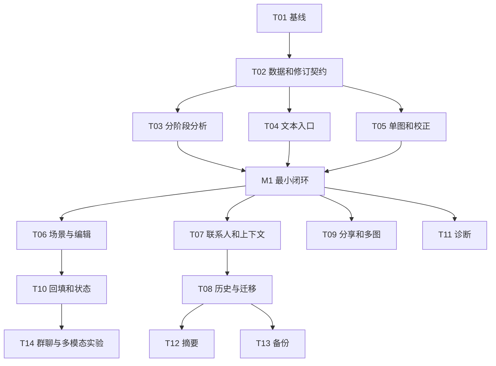

# 实施路线、任务拆分与验收

日期：2026-11-11 · 状态：待排期。此处的任务、指标和测试均为计划，未表示已经实现或通过。

关联文档：[产品设计](product-design.md)、[技术契约](architecture.md)、[文档导航](../README.md)。

## 1. 交付方式

每个任务交付一个可演示的行为变化、相应测试或真实验证记录，以及受影响的文档更新。先完成最小闭环，再扩展能力；不要求先搭完全部新架构。

以当前源码为基线，不将历史 v1.3 方案中的已收窄功能当成已实现。各阶段通过验收才进入下一阶段，不预先承诺发布日期；正式版本号在发布时决定。

## 2. 阶段与依赖

| 阶段 | 交付结果 | 进入条件 | 完成条件 |
|---|---|---|---|
| M0 基线 | 可复现的构建、现有行为和已知限制 | 当前工作区可审阅 | 原有测试结果、设备矩阵、配置基线完整 |
| M1 可用闭环 | 快速回复＋单图／文本导入＋校正＋复制 | M0；基础模型契约明确 | 无无障碍权限也能完成导入任务，排序故障不丢候选 |
| M2 回复与记忆 | 场景控制、编辑、上下文预览、联系人消歧、历史分段 | M1 | 不串联系人，输入可核对，局部失败可恢复 |
| M3 完整体验 | 多图、分享、诊断、回填草稿保护、确认式摘要 | 相关 M2 契约稳定 | 真机矩阵通过，缓存和删除行为可验证 |
| M4 扩展实验 | 群聊、多模态、备份、大型本地模型评估 | M3 核心质量达标 | 每项独立数据和资源评测，达标后决定发布范围 |



图中分支表示依赖关系，不要求同时修改同一服务或 Gradle 文件。网络取消、模型结构和迁移有交叉影响时，按接口先稳定再接入的顺序实施。

## 3. 可执行任务

### T01：锁定基线与现有回归，P0

- 范围：Gradle 构建、现有 capture 测试、`docs/acceptance.md`、README 与隐私说明的事实差异。
- 输出：真实构建结果、运行配置、测试数量、失败原因；记录已安装目标应用版本和设备环境。
- 验收：没有把历史截图或研究结果当作本轮实测；现有改动均保留；构建受环境限制时明确记为未验证。
- 发布前单列检查应用身份、签名与数据迁移路径，不在调试构建中隐式更改用户已安装应用。

### T02：消息、草稿、修订号和状态契约，P0

- 范围：`ChatModels`、`ConversationSession`，新增纯 Kotlin draft/state 模型及旧适配器包装层。
- 输出：未知角色、来源、消息类型、导入任务 ID、runId 与 revision。
- 验收：旧适配器仍可工作；编辑、切换目标使旧回调和旧候选失效；同名标题不自动绑定联系人。
- 测试：旧任务晚完成、切换后返回同会话、导入与实时任务交替、配置变更、系统消息混入。

### T03：快速回复与分阶段失败恢复，P0

- 范围：`JevClient`、`JudgeClient`、`ReplyClient`、`HttpJson`、服务分析编排及状态展示。
- 输出：只配置回复接口即可使用；生成成功先展示；排序可跳过或单独重试；实际请求可取消。
- 验收：排序返回 401、429、超时、空结构时仍保留候选；单条候选不显示 100% 成功率；重试排序不再次生成。
- 测试：可控 HTTP 服务验证尝试次数、deadline、取消和不重试鉴权错误；旧响应不能覆盖新轮状态。

### T04：粘贴文本与临时会话，P0

- 范围：新增导入入口、对话编辑器、工作台，沿用 Views。
- 输出：手动粘贴、角色设置、消息编辑、选择回复对象、生成与复制。
- 验收：无无障碍和悬浮窗权限可完成流程；粘贴不自动联网、不自动建联系人；返回保留本轮编辑状态。
- 测试：空文本、超长输入、混合语言、多行消息、未知角色、旋转屏幕、返回确认。

### T05：单张截图与 OCR 校正，P0

- 范围：系统图片选择、受控解码、现有 OCR 引擎适配、来源区域、编辑器。
- 输出：预览裁剪、原图对照、改字、拆分合并、角色修正、删除、撤销。
- 验收：整屏 OCR 不默认全部标为对方；正文不充当可信标题；取消后资源与临时文件可清理。
- 测试：无 GMS 设备选择器回退、损坏图片、超大图、旋转图、无权限 URI、图片中无文字、低内存中止。

### T06：回复场景、目标和候选编辑，P1

- 范围：提示词构造、结构化解析、工作台／悬浮卡、联系人关系覆盖。
- 输出：日常／工作、目标、语气、长度；候选编辑、撤销、缩短与改写。
- 验收：改写产生新版本；排序晚到不打断编辑；事实缺失时不生成确定交付时间或未经用户确认的承诺。
- 测试：每个场景至少 10 个去标识样本；另测 JSON 格式错误、解释段落、重复候选和长文本。

### T07：联系人消歧与上下文选择，P1

- 范围：`KbStore.findContact`、`ContextBuilder`、联系人 UI、上下文抽屉。
- 输出：明确绑定、范围和有效期、统一预算、提供给模型的内容预览、本轮排除。
- 验收：同名多个匹配不取首项；排除项不进入判断和回复请求；常驻笔记超限也触发裁剪或提示。
- 测试：跨应用同名、群名变化、别名冲突、空标题、笔记过期、固定内容超限和无匹配。

### T08：历史分段与可靠迁移，P1

- 范围：JSON schema、历史记录职责拆分、文件版本切换、删除 epoch。
- 输出：采集时间与消息时间分离；无重叠片段不丢失、不伪造顺序；迁移失败可恢复。
- 验收：重新生成不重复写历史；旧文件损坏不会被空文件覆盖；删除后晚到摘要或写入不恢复数据。
- 测试：重复短消息、向上滚动、离开后整屏新消息、多图乱序、原子切换前后中断、空间不足、旧版本回退。

### T09：系统分享与多图导入，P1

- 依赖：T04、T05 的同一编辑器，不新增另一套解析流程。
- 输出：接收文本／图片分享，批次排序、分段和重叠建议。
- 验收：非法内容给出可读错误；多图部分失败允许处理成功项；新 Intent 不覆盖未保存编辑；无重叠默认保留分段。
- 测试：临时 URI 授权撤销、同图重复分享、超过批次限制、消息内容相同但不是同一条、不同会话截图混入。

### T10：状态面板与回填草稿保护，P1

- 范围：`OverlayController`、`GuardedInputWriter`、`FillController`、能力状态页。
- 输出：阶段状态、目标和候选过期原因；已有输入的保留／替换／追加选择。
- 验收：任何路径不点击发送；目标变化不能填入；旧输入已被用户改动时不提供自动恢复；导入首版只复制。
- 测试：键盘出现、切窗、已有草稿、重复点击、写入后目标变化、粘贴失败、后台恢复、放大字体。

### T11：本地诊断与用量，P1

- 范围：脱敏诊断事件、设置页、阶段耗时与请求计数。
- 输出：有界本地记录、导出预览、清空和错误恢复建议。
- 验收：日志与导出无聊天正文、联系人名称、密钥、原始响应；缺少用量显示未知；静默不新增模型调用。
- 测试：服务端回显敏感值、URL 查询参数、超量事件滚动淘汰、清空后写入竞争。

### T12：确认式摘要与偏好，P2

- 依赖：T07、T08。
- 输出：用户选择范围、生成草稿、对照来源、编辑确认、版本替换和删除。
- 验收：未确认摘要不进入长期背景；旧摘要与新事实冲突可见；删除源历史后相关摘要提示处理，不悄悄保留隐藏副本。
- 测试：生成中删除联系人、来源修订、摘要缺事实、跨联系人混入、重复确认、取消。

### T13：用户控制的备份恢复，P2

- 依赖：T08；实施前完成加密格式与密钥管理评审。
- 输出：选择范围、默认排除密钥和图片、用户选文件、预览差异、可回滚合并。
- 验收：错误口令、未知 schema、损坏文件不改变现有数据；明确外部备份不会随应用内清空被删除。
- 测试：ID 冲突、重复恢复、路径穿越输入、空间不足、导出中断、认证校验失败。

### T14：群聊、多模态与本地模型实验，P2

- 将群聊、视觉理解、音频转写、大型本地 OCR 分成独立实验，不一次性纳入发布。
- 群聊要求参与者和回复对象标注；多模态先验证用户明确选择的输入，不能自动扩展到所有截图。
- 评估质量、峰值内存、冷／热启动、包体与下载体积、离线行为、取消恢复、温升和耗电。
- 验收：有对照样本和测量报告；未完成实机推理不得标为已支持；每项单独决定发布或保持实验状态。

## 4. 验收矩阵

| 编号 | 场景 | 通过条件 |
|---|---|---|
| A01 | 只配回复接口，所有辅助权限关闭 | 粘贴文本到候选复制闭环完成 |
| A02 | 判断成功、生成失败 | 保留判断，重试生成不重复判断 |
| A03 | 生成成功、排序超时 | 候选始终可编辑复制，失败阶段可重试 |
| A04 | A 会话启动，切 B 后 A 返回 | B 的状态和输入不受 A 影响 |
| A05 | 同名联系人来自两个应用 | 不静默合并或注入错误历史 |
| A06 | OCR 出现未知说话人 | 提示校正，模型不收到伪造的确定角色 |
| A07 | 前后两屏完全无重叠 | 内容保留为待确认片段，不丢失或强行排序 |
| A08 | 常驻资料大于总预算 | 有明确超限处理，请求规模仍受控 |
| A09 | 请求中删除联系人／清空历史 | 晚到任务不恢复数据 |
| A10 | 导入大图期间取消／重建界面 | 不崩溃，资源释放，临时内容可恢复或解释性结束 |
| A11 | 排序返回时用户正在改写候选 | 文本、焦点、候选身份不变 |
| A12 | 目标输入框已有未发送草稿 | 未明确选择替换前不覆盖 |
| A13 | 截图不允许或应用策略禁止 | 不反复尝试，给替代入口与准确原因 |
| A14 | 静默 10 分钟 | 无模型调用，无无效截图轮询 |
| A15 | 返回恶意／畸形模型内容 | 不执行指令，不当作可信候选填入，不泄露原始响应 |
| A16 | JSON 迁移被中断 | 重启可读旧版本或完整新版本，不出现半迁移数据 |

## 5. 测试资料和设备覆盖

测试优先使用虚构内容及脱敏 fixture，不把私人聊天提交进仓库。建议新增 `fixtures/ocr`、`fixtures/context`、`fixtures/network` 分类，记录预期结果和采样条件。

| 类别 | 首批建议覆盖 |
|---|---|
| 文本 | 中英混合、多行、表情、引用、时间、系统提示、重复短句 |
| OCR | 左右气泡、全左对齐、长消息、键盘遮挡、深色、字号变化、横屏 |
| 系统 | minSdk 对应 Android 11、API 34、当前目标机 Android 16；分别记录模拟器或真机 |
| 设备 | 当前小米 14 优先；另选一台内存较低设备，机型待取得后记录 |
| 接口 | 成功、格式错、无响应、断连、401、403、429、5xx、取消 |
| 生命周期 | 旋转、后台、进程终止、重复 Intent、权限撤回、用户连续操作 |

首批 OCR 可从 30 张标注截图开始，联系人／上下文至少 20 个确定性案例，回复评估至少覆盖两场景各 10 段对话。样本量是启动门槛，不代表统计上充分；报告列出各类分布，避免只测简单样本。

## 6. 指标定义与建议目标

所有耗时用单调时钟；统计需注明应用版本、设备、温度／内存状态、模型、网络、样本数及冷／热启动。外部服务速度不可用固定本机数字承诺。

| 指标 | 定义 | 初始建议目标 |
|---|---|---|
| 操作反馈 | 点击到界面显示正在处理 | 本地交互 P95 ≤ 200 ms |
| 本地 OCR 耗时 | 受控解码开始到可编辑结果 | 当前目标机单图热运行 P95 ≤ 2 s，至少 30 次；需实测 |
| 候选可用耗时 | 确认生成到第一组合法候选可编辑 | 分供应商报告 P50/P95，先测基线再设发布目标 |
| 排序失败保留率 | 排序失败时仍保留生成结果的比例 | 确定性故障测试 100% |
| 跨会话误填 | 失效候选成功写入次数 | 回归与真机检查为 0；发生一次即阻断发布 |
| 角色可靠性 | 已标明身份消息的准确率及未知占比 | 分开报告，不通过全部标为未知粉饰准确率 |
| 导入成功率 | 合法样本完成预览和编辑的比例 | 首批固定验收集全部通过，另报告未覆盖格式 |
| 资源恢复 | 取消和连续导入后的内存／临时文件 | 无持续增长趋势；临时数据遵守既定保留期限 |

回复质量由人评“事实一致、目标满足、语气合适、无需修改可用”四项，记录失败例和修改原因；模型自身排序分数不作为质量验收唯一依据。

## 7. 验证命令与交付记录

以下是在 `cn/` 下准备执行的命令，不是本次已运行结果。需要可用 JDK、SDK 和依赖缓存；不因命令列在文档中就视为通过。

```bash
./gradlew testDebugUnitTest
./gradlew assembleDebug
./gradlew lintDebug
```

每次代码任务按实际改动运行必要检查；文档任务只做 Markdown、链接及差异检查。真机操作由任务范围决定，安装前核对包名、签名和设备，避免误卸载导致数据丢失。

报告模板：

```text
任务 ID / 修改版本 / 日期
解决的用户问题与最终行为
变更文件与兼容影响
运行环境、配置和样本
实际执行命令、退出码和关键原始输出
测试与真机结果（通过／失败／未执行）
剩余限制和复现方法
回滚方式及数据兼容性
```

## 8. 发布检查与回滚

- 每项新能力默认状态明确，未验收实验不出现在稳定版支持表。
- 现有会话隔离、人工发送和应用策略回归通过；新入口不扩大自动采集范围。
- 独立入口不强制辅助权限；涉及上传的数据范围和保存期限可在产品内查看。
- 升级保留用户配置和默认关闭的历史；迁移损坏有恢复路径；回滚读取能力有明确版本边界。
- README、隐私说明、设置文案、能力表和实际调用顺序一致。用本阶段指标替换不适用的历史统一延迟承诺。
- 正式发布身份与签名属于本项目；不把当前实验包名视为长期升级方案。

新编排、导入、历史分段分别设功能开关。关闭新功能可回退 UI 或执行路径，但不能让旧逻辑忽略新 schema：数据迁移一旦写入不兼容格式，必须通过版本隔离或已验证恢复流程回退。

## 9. 推荐首轮范围

按 T01 → T02 → T03 → T04 → T05 推进。首轮演示只要求：不开无障碍，导入一张聊天截图，修正双方身份，生成候选；人为让排序失败，候选仍可编辑并复制。

这条演示通过后再进入联系人记忆和更多应用适配。它同时验证输入、身份、模型降级与交互闭环，能尽早发现最影响实际使用的问题。
