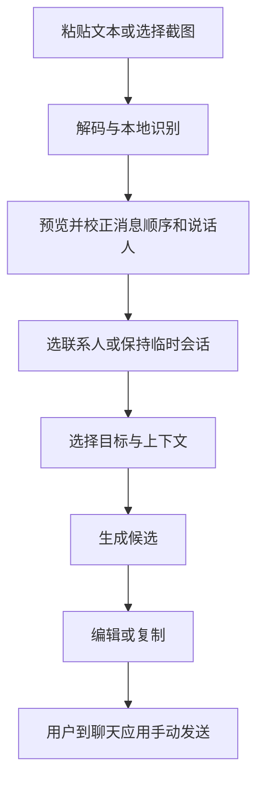

# 聊天助手下一阶段产品设计

日期：2026-11-11 · 状态：待实施设计 · 基线：当前工作区 Android 代码。

## 1. 产品目标

把当前悬浮式回复助手扩展为可校正、可解释、可恢复的对话工作台。用户既能在聊天应用旁使用，也能通过粘贴文字、导入截图独立完成分析。

核心闭环为：获取有权处理的内容 → 确认对话及说话人 → 选择回复目标 → 生成可编辑候选 → 复制或确认目标后填入 → 用户手动发送。

本次交付只包含设计文档，没有修改业务代码、安装 APK、操作手机或接入新模型。下文所有新增能力都是提案，目标数值不是已测性能。

## 2. 已有能力和真实缺口

以下路径相对项目根目录。源码链接对应当前目录布局，未来恢复项目自有包名时需同步更新。

| 领域 | 当前实现依据 | 缺口与影响 |
|---|---|---|
| 应用采集 | [ChatAppAdapter](../../app/src/main/java/com/dianming/phoneapp/capture/ChatAppAdapter.kt) 和 [WhatsAppAdapter](../../app/src/main/java/com/dianming/phoneapp/capture/WhatsAppAdapter.kt) | `null / 空消息 / 有消息` 难以表达页面不支持、内容不可读、加载中等差异 |
| OCR | [MyAccessibilityService](../../app/src/main/java/com/dianming/phoneapp/MyAccessibilityService.kt) 的 `ocrWholeScreen/groupOcrLines` | 整屏识别全部标为对方；标题可能取正文第一行；缺少校正流程 |
| 消息结构 | [ChatModels](../../app/src/main/java/com/dianming/phoneapp/core/ChatModels.kt) | `Msg(side,text)` 无说话人身份、来源和消息类型，难以支持群聊与多模态 |
| 独立入口 | [AndroidManifest](../../app/src/main/AndroidManifest.xml) | 未声明文本／图片分享入口；导入分析尚未形成独立闭环 |
| 模型编排 | [JevClient](../../app/src/main/java/com/dianming/phoneapp/jev/JevClient.kt) 与服务 `runAnalysis` | 分析入口强制要求判断密钥；多候选生成后排序失败会中断候选返回 |
| 回复控制 | [ReplyClient](../../app/src/main/java/com/dianming/phoneapp/jev/ReplyClient.kt) | 固定短回复策略，缺少场景、目标、长度与候选内编辑 |
| 会话保护 | [ConversationSession](../../app/src/main/java/com/dianming/phoneapp/capture/ConversationSession.kt) 与 [GuardedInputWriter](../../app/src/main/java/com/dianming/phoneapp/capture/GuardedInputWriter.kt) | 已有会话令牌和写入检查，应保留；同名会话及导入内容仍需更明确的身份边界 |
| 记忆 | [KbStore](../../app/src/main/java/com/dianming/phoneapp/core/kb/KbStore.kt) 与 [ContextBuilder](../../app/src/main/java/com/dianming/phoneapp/core/kb/ContextBuilder.kt) | 同名匹配有歧义；无重叠屏幕被视为旧消息；常驻笔记不受统一预算约束 |
| 摘要 | [KbModels](../../app/src/main/java/com/dianming/phoneapp/core/kb/KbModels.kt) | 有预留字段和生成方法，未接入确认、保存、更新的完整流程 |
| 测试 | [capture 测试目录](../../app/src/test/java/com/dianming/phoneapp/capture) | 已覆盖会话、新消息门控、回填、WhatsApp 规则；应补上下文、OCR、网络降级与迁移 |

静态观察不能替代真机验证。例如无重叠历史规则存在漏记新消息的可能，需要用“离开后收到整屏新消息”的样本复现。

## 3. 产品原则和范围

- 保留手动发送和目标复核；不增加自动点击发送、批量外发或后台代聊。
- 使用项目自有应用身份。隐藏节点或系统禁止截图时显示能力限制，不依靠伪装服务、修改目标应用或读取其私有数据库。
- 保留 WhatsApp 禁截图、群聊暂不支持等已有应用策略，新增通用入口也不能隐式覆盖这些策略。
- 本地 OCR 是默认图片处理路径。视觉模型处理真实图片属于后续独立能力，启用前必须展示接收端和发送范围。
- 历史记录默认关闭。关闭记录、排除本轮上下文、删除已有数据是三个不同动作。
- 保持 Views 与 JSON 的渐进改造，不把更换 UI 框架或数据库作为功能扩展前提。

## 4. 信息架构

| 页面／入口 | 主要任务 | 默认展示 |
|---|---|---|
| 首页 | 开始任务、了解状态 | 粘贴文本、导入截图、悬浮模式；只展示所选模式所需配置 |
| 对话校正页 | 确认输入 | 来源预览、消息序列、说话人、会话标题、排除无关内容 |
| 回复工作台 | 获取并修改建议 | 回复目标、候选、局部失败提示、分析摘要 |
| 上下文抽屉 | 核对模型参考资料 | 本轮选中的联系人、笔记、历史和摘要；支持临时排除 |
| 联系人与知识库 | 管理长期资料 | 应用内身份、别名、关系、笔记、保留策略、摘要草稿 |
| 设置与诊断 | 配置能力、定位问题 | 三路接口、应用能力、最近阶段状态、脱敏诊断 |
| 悬浮卡片 | 快速处理当前会话 | 当前目标、阶段、少量候选；复杂校正跳转工作台 |

首页不应要求导入模式用户开启无障碍和悬浮窗。开启相关模式时再展示相应权限说明与检查。

## 5. 三条用户流程

### 5.1 文本／截图导入

首批支持一张截图和粘贴文本；多图拼接、系统分享随后接入相同流程。导入任务有独立本地 ID，不以截图 OCR 出的标题绑定真实聊天。首批导入结果仅提供编辑和复制。

校正页应支持：消息改字、说话人切换、拆分、合并相邻消息、删除、调整顺序、撤销。修改后重新生成时，旧候选标为“基于修改前内容”，不可静默当成新结果。

如果仍有未知说话人，用户可以先做不依赖身份的摘要；生成定向回复前应指定“我是谁、回复谁”。不能把未知消息直接改成对方。

### 5.2 当前聊天辅助

进入支持的聊天 → 确认应用与会话 → 读取节点或按应用策略 OCR → 获取有效快照 → 自动或手动分析 → 展示候选 → 用户选中 → 再次确认当前目标 → 填入后停手。

切到其他会话立即撤销旧结果的回填资格。保留既有会话隔离保护。当前会话收到新消息时，旧候选标记过期；不得用新令牌给旧候选重新授权。

回填发现用户已经输入文本时，展示“保留草稿／替换／追加”的明确选择。只有本应用刚写入的内容仍原样存在、目标未变化时，才可提供恢复原稿操作。

### 5.3 一次失败后的恢复

| 情况 | 展示 | 可继续的动作 |
|---|---|---|
| 节点不可读 | 当前页面无法读取文字 | 导入用户已有截图、粘贴文本；系统允许且应用策略允许时手动截图 |
| OCR 未识别出文字 | 没有得到可用文字 | 裁剪、换图、手动录入 |
| 只有回复接口可用 | 快速回复模式 | 生成候选，不显示虚构的分析分数 |
| 判断失败、生成成功 | 候选保留，分析暂不可用 | 编辑、复制或重试判断 |
| 生成成功、排序失败 | 原始候选保留，尚未排序 | 使用候选或只重试排序 |
| 联系人有多个匹配 | 显示匹配项 | 手选或本轮不带联系人记忆 |
| 页面或目标变化 | 当前候选已过期 | 复制旧稿，或读取新会话重新生成 |
| 断网 | 本地识别与编辑仍可使用 | 复制文本；用户主动重试联网生成 |

## 6. 回复工作台

### 场景与目标

场景首批采用“日常、工作”两组，后续再扩展客户与关系沟通。场景控制提示词与可选维度，不暗中替用户改变目标。

| 场景 | 可选目标 | 约束 |
|---|---|---|
| 日常 | 承接、回答、约时间、结束话题 | 保留自然表达，避免无依据解读动机 |
| 工作 | 澄清、同步进展、拒绝、提出安排 | 不编造完成状态、交付时间、授权或承诺 |
| 客户，后续 | 回答问题、说明限制、给下一步 | 只引用已确认资料，缺失事实提示补充 |
| 关系，后续 | 表达感受、说明边界、缓和冲突 | 将意图判断表述为可能解释，并提供文本依据 |

风格作为独立选项：自然／正式／坚定；长度：短／中／长。关系描述来自本轮选定联系人，用户可覆盖，不用单个全局关系替代所有人。

候选卡增加编辑、缩短、换语气、复制和填入。任何模型改写生成新候选版本，保留原稿可撤销。第一版先完成非流式候选可靠显示，流式展示后续按供应商能力接入。

### 解释与反馈

- 分析先展示“对方明确问了什么”和引用的消息，再展示可能的意图，避免把模型推断当成事实。
- 候选排序显示“推荐顺序”；原始分数仅在详情中解释为模型偏好，不能表述为成功率。
- 用户可标记“事实不符、语气不对、太长、遗漏问题”。反馈默认只影响本轮重写；长期偏好需用户主动保存。
- 不根据填入推断已经发送，也不监听发送动作来自动建立训练数据。

## 7. 可靠记忆

1. **联系人消歧**：应用、会话显示名和用户绑定共同定位。多个同名结果不自动择一；没有可验证稳定 ID 时保留不确定状态。
2. **历史分段**：记录采集时间与可得的消息时间，无法判断先后时建立新片段，不冒充连续完整历史。
3. **资料范围**：笔记可指定联系人／场景／全局范围，以及过期时间。常驻意味着优先考虑，仍受总预算限制。
4. **引用预览**：显示采用的资料、来源、截取原因、未采用原因；本轮排除不删除原始笔记。
5. **摘要草稿**：仅对用户选择的历史范围生成，分别展示事实、偏好、承诺、待办；确认后写入，可修正和删除。
6. **矛盾处理**：旧笔记与最新消息冲突时展示冲突项，不自动覆盖联系人事实。
7. **保留管理**：按联系人清空、按时间清理、删除摘要及关联草稿；默认保持原来的历史关闭状态。

先做好可解释的关键词检索，再用离线样本决定是否需要语义检索。无需首批引入向量库或云端知识库。

## 8. 群聊和多模态扩展

群聊必须有参与者与回复对象，不能只把所有非本人消息合成一个“对方”。初期允许用户手动标注参与者，使用限定片段回答；原本禁止群聊的应用继续遵守既有策略，支持状态需要独立验收。

图片消息先展示占位和用户补充说明，语音先接收用户已有转写文本。后续视觉理解、音频转写分别配置能力与数据发送范围，不能因配置了视觉测试接口就自动上传真实截图。

Xiaomi-OCR-0 等大型本地模型保留实验入口设想。只有完成内存、冷启动、识别质量、耗电和取消恢复的对比实测后，才决定是否纳入产品；不把下载完成当成推理可用。

## 9. 功能优先级

| 优先级 | 功能 | 交付价值 |
|---|---|---|
| P0 | 快速回复与排序降级 | 模型单路故障仍有可用结果 |
| P0 | 单图／文本导入、校正、复制 | 无障碍不可用时仍能完成主要任务 |
| P0 | 未知身份、候选过期、阶段错误 | 减少错误上下文和误填 |
| P1 | 场景目标、候选编辑、上下文预览 | 提升回复可控性与可信度 |
| P1 | 联系人消歧、统一预算、历史分段 | 使记忆不会串人或伪造连续性 |
| P1 | 多图、分享入口、诊断面板 | 扩大覆盖和降低排障成本 |
| P2 | 确认式摘要、备份恢复、反馈偏好 | 完善长期使用体验 |
| P2 | 群聊、图片语义、语音、大模型实验 | 在前述质量稳定后扩展边界 |

具体任务和验收见 [实施路线](delivery-plan.md)。

## 10. 文档与产品表述同步

当前服务已并行运行判断和回复相关任务；旧 README 的“先判断再写字”和隐私文档中的串行描述需要在发布前对照真实调用更新。旧验收中的统一 1.5 秒要求应改为分阶段、分设备、分供应商的测量，不能由文档声明成已达标。

增加导入缓存、摘要或备份时，要同步数据类别、保留时间、删除路径；开放真实图片上传时要同步用户界面和隐私说明。保留历史研究文档，新增版本化实测记录，不将旧机型结果标成通用能力。
