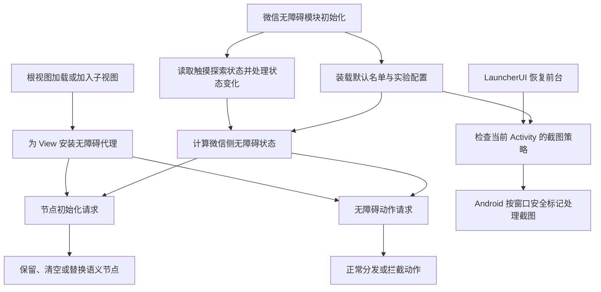

# 微信 8.0.80 的无障碍自动化与截图控制

分析样本为手机导出的 `com.tencent.mm` 8.0.80 `base.apk`，SHA-256 为 `9d9b6c516e8e07e437c81485fde21fe13ce4f61b37d19e793fff40c71be39c0e`。REA 6.8.0 的 `inspect-artifact` 完成 APK 清点并确认哈希，证据 ID 为 `ev_83efa957df219a347b0a22089833d776f5e45bdf98942d9ea6063a58fc182375`。为 REA 配置并校验了固定版本的 JADX MCP 0.7.1 JAR 后，Android 方法检查仍在启动阶段失败。本机 Swift 工具链报告 `SwiftBridging` 模块重复定义。因此下面的方法级调用关系来自 Android SDK `dexdump`。 [REA Android 分析文档](https://github.com/morluto/rea/blob/main/docs/android-analysis.md)

## 整体调用链

### 初始化和状态刷新

- `classes13.dex` 的微信内部 `AccessibilityService.onCreate()`（`0x2b6140`）从 Android `AccessibilityManager` 读取 `isTouchExplorationEnabled()`，保存初始状态，并注册状态回调。`onTouchExEnableChange()`（`0x2b62a0`）会取消尚未完成的旧任务。触摸探索开启且配置了确认延时的分支会安排一次延后重读，关闭时直接更新。短时间内切换读屏后，节点状态可能还在过渡。
- `AccExptService.onCreate()`（`0x2b5c68`）初始化策略。`onReceiveStrikeMsg()`（`0x2b5c90`）把收到的数据交给 `AccConfigManager`，接受后再次初始化。`classes8.dex` 的 `getConfigData()`（`0x22bb44`）读取本地 MMKV 的 XML 和接收时间，解析配置并检查是否过期。白名单另由 `classes7.dex` 的默认条目初始化，再追加实验配置 `clicfg_acc_white_service_list` 的非空条目。手机当前的实验配置值未采集。
- `AccUtil.isAccessibilityEnabled()` 把触摸探索、名单和账号条件合成微信侧判断。名单与账号判断有约三秒的结果缓存。Android 的已启用服务列表是这一判断的输入之一，服务统计模块也会读取同一列表。

### 代理挂载和请求处理

`classes13.dex` 中，`AccProviderFactory` 的异步根视图加载回调（`0x2b1524`），以及 `MMBaseAccessibilityConfig` 的子视图加入回调（`0x2ac238`、`0x2ac624`），都会调用 `AccNodeUtil.checkDelegate()`（`0x2b6994`）。该方法通过 `View.setAccessibilityDelegate()` 安装 `MMAccessibilityDelegateWrap`，并可包装现有代理。这把微信的策略接到了 Android 的节点和动作入口。

节点请求进入代理后，可以在原代理初始化前提前结束。走正常路径时，代理可用缓存或由 `AccProviderFactory` 补充节点信息，后面还有替换内容与再次清空的分支。动作走独立入口，拦截分支可能在调用原代理之前返回 `true`。因此，排查读取问题时要检查实际的字段和边界，排查动作时要核对预期的页面变化。

## 无障碍节点与动作

以下地址是该样本 `classes13.dex` 的方法偏移。它们用于定位静态证据，其他版本的偏移和资源 ID 可能变化。

| 方法 | 偏移 | 行为 |
| --- | --- | --- |
| `AccExptService.checkHasServiceInList` | `0x2b4bc8` | 从 Android 查询已启用服务，读取包名和类名，再与微信自身的配置匹配。名单参与状态判断，也有独立的服务统计调用。 |
| `AccUtil.isAccessibilityEnabled` | `0x2b6cd4` | 除强制配置分支外，触摸探索开启可直接判定为启用。其余情况才评估服务名单和账号条件。 |
| `MMAccessibilityDelegateWrap.onInitializeAccessibilityNodeInfo` | `0x2af57c` | 根据策略跳过节点初始化、清空节点信息或替换节点内容。因此空根、空字段和返回了不可信内容都应单独识别。 |
| `MMAccessibilityDelegateWrap.performAccessibilityAction` | `0x2af3d4` | 拦截分支可返回 `true`，同时跳过正常动作分发。调用结果不能单独证明界面已发生预期变化。 |

### 真机对照

在同一台小米手机和同一个微信聊天页，关闭读屏时，连续两次 `uiautomator dump` 都只返回一个零尺寸空根。Google TalkBack 和小米 TalkBack 增强服务同时启用时，连续两次都返回 115 个微信节点，测试消息 `OCR_TEST_123` 位于 `com.tencent.mm:id/bkl` 的 `TextView.text`，并有有效屏幕坐标。

这次对照证明 UIAutomator 的可见节点随读屏状态变化。两个服务同时启用，无法从对照中区分触摸探索和名单分支。尚未用项目自己的服务验证正文可读性，也未在真机上验证动作拦截分支。

## 窗口截图控制

`classes13.dex` 中的 `AccExptService.checkEvilServiceStatus(Activity)`（`0x2b552c`）有两条设置 `WindowManager.LayoutParams.FLAG_SECURE` 的路径：服务匹配微信限制名单，或者截图限制配置启用且当前 Activity 命中配置的页面列表。窗口标记和无障碍节点由不同路径控制，因此节点可读性不能用来推断截图可用性。静态分析确认了这些路径存在，尚未确认此前测试的微信聊天页是否命中截图限制。 [Android 安全窗口文档](https://developer.android.com/security/fraud-prevention/activities#flag_secure)

跨 DEX 引用确认 `classes15.dex` 的 `LauncherUI.onResume()`（`0x428124`，调用指令偏移 `0x429af8`）会把当前 Activity 传给该检查。检查针对传入的 `Activity.getWindow()` 设置安全标记。此处确认的是 `LauncherUI` 恢复时的调用路径，`ChattingUI` 上是否走同一路径及其最终窗口标记仍待验证。

Android 14 起，`takeScreenshotOfWindow()` 可以截取指定窗口。其回调错误码 `5` 表示窗口 ID 无效，`6` 表示窗口包含受保护内容。整屏捕获中的受保护区域也可能为空白。只有拿到有效画面，才适合进入 OCR。 [Android 截屏 API](https://developer.android.com/reference/android/accessibilityservice/AccessibilityService#takeScreenshotOfWindow(int,java.util.concurrent.Executor,android.accessibilityservice.AccessibilityService.TakeScreenshotCallback))

## 对 cn 的影响

- 2026-11-11 复测发现消息列表 `bp0`、输入框 `bkk` 和正文 `bkl` 可见，标题容器 `obq` 没有文字。适配器改用列表和输入框确认页面结构。Jev 自己的无障碍服务在同一页面通过「读树」读到 `OCR_TEST_123`，标题仍未公开。配置了会话白名单时需核对标题。无法确认会话身份时仍无法启动手动截图，整屏 OCR 不分双方。见 [结构适配验证](../_reports/wechat-structured-tree_report.md)。
- 同一版本的长消息实测显示，列表边缘的消息可能保留 `bkl` 正文，但其 `bk1` 头像已滚出屏幕。已保留这类正文供手动预览，发送方显示「未确认」。同屏其余消息继续按行内头像分边。见 [长消息验证](../_reports/wechat-long-bubble_report.md)。
- 读树预览中的「校正并分析」将标题缺失或包含未确认发送方的正文带入独立草稿。用户确认角色并提交后，复用 Jev 判断和候选回复流程。草稿可编辑、切换并复制回复，不与实时会话或联系人历史绑定。见 [接入验证](../_reports/wechat-tree-review_report.md)。
- `ScreenCapture` 在 Android 14 及以上且有有效窗口 ID 时优先尝试窗口截图。窗口 ID 缺失或调用同步抛异常时使用整屏截图。系统异步回调失败会直接返回结果，代码不会因此再发起整屏截图。
- 诊断时分别记录树的状态和截图的状态。树侧记录包名、节点数及测试标记是否命中，截图侧区分无效窗口、受保护窗口和有效画面。测试用例使用预先准备的测试消息，避免把真实聊天正文写进日志。

| 观察结果 | 可归因的层级 |
| --- | --- |
| 窗口焦点属于微信，根只有零尺寸节点 | 已定位窗口，当前查询未得到可用语义。单独记录调用方和触摸探索状态。 |
| ADB 可读，项目服务读不到正文 | 先比较两边的窗口包名和节点统计，再判断调用方可见性或项目过滤。 |
| 节点与测试文字可读，截图错误码为 `6` | 语义树可见，系统拒绝了这次受保护窗口截图。 |
| 已获有效截图，识别结果为空 | 查裁剪范围、画面清晰度和 OCR 处理。 |
